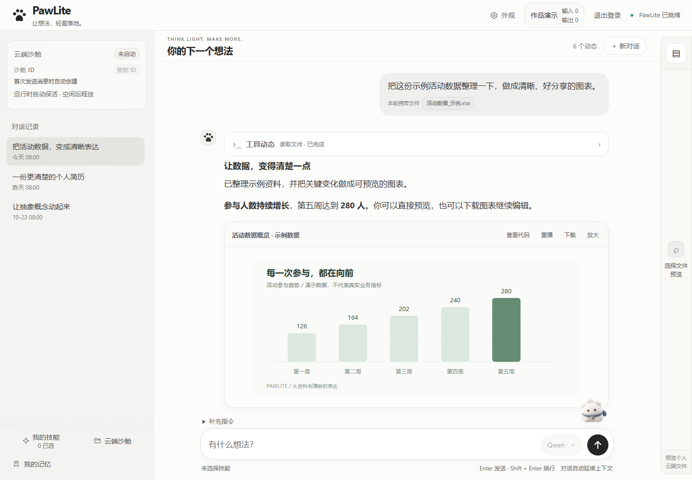
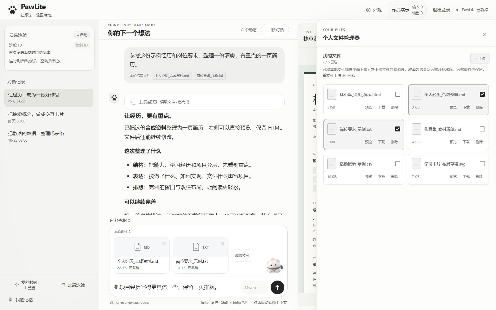

  

  <strong>一个围绕文件、工具与作品交付设计的云端 AI Agent。</strong> 
  说出想法，带上资料，看到执行过程，把结果带走。

  <a href="https://pawlite-ai.creamywhale259.chatgpt.site"><strong>在线体验 ↗</strong></a>
  &nbsp; · &nbsp;
  <a href="#把需求变成看得见的结果">功能与画面</a>
  &nbsp; · &nbsp;
  <a href="DESIGN.md">设计原理</a>

 

  
  实际界面 · 演示数据

## 把需求变成看得见的结果

PawLite 把对话、资料、工具执行和作品预览放进同一个工作区。它关注一次任务的完整过程：怎样开始、怎样看进度、怎样继续，以及怎样拿到最终文件。

### 01 / 让资料更容易理解

> “把这份活动数据整理一下，做成清晰、好分享的图表。”

上传资料，选择本轮要使用的文件，在对话里说明目标。正文、工具动态和阶段进度逐步呈现，生成的图表或页面可以直接预览，再下载继续使用。

**适用方向：** 表格整理、数据表达、图文资料处理。

### 02 / 让作品留在工作流里

> “把这些经历整理成一份简洁的简历，先给我看页面效果。”

文件生成后，预览和下载入口随任务保存。HTML、SVG、图片与音视频按格式呈现；用户可以围绕已有资料继续提出修改要求。

  
  实际界面 · 合成作品示例

**适用方向：** 简历 HTML/PDF、交互式教学演示、内容与媒体作品。具体产物按任务检查内容、版式与质量。

### 03 / 让下一次工作更顺手

> “这次用这些资料，沿用我选好的技能继续做。”

工作区文件按需选择，粘贴的图片作为消息附件保存；Skills 承载场景方法，个人技能可以导入和复用。会话、资料和任务结果保持关联，减少在多个工具间反复搬运。

  
  实际界面 · 演示资料

## 轻盈的界面，完整的工作过程

- **过程可见。** 流式正文、工具状态与阶段进度，让等待有具体反馈。
- **工作可续。** 刷新、切换会话或网络恢复后，读取任务快照，续接同一请求的新事件。
- **任务可控。** 支持暂停与排队；同一会话内按顺序协调执行。
- **输入灵活。** 文件、粘贴图片与图文消息各有对应的保存和使用方式。
- **结果可带走。** 产物归档后关联任务，之后仍可获取预览与下载入口。
- **技能可复用。** 通用执行链路配合个人 Skills，支撑不同类型的工作。

## 离开电脑，也能接着用

桌面与手机沿用同一套账号和会话数据。移动端针对触控、导航、输入区和作品预览调整布局，让查看任务与继续对话自然衔接。

  
   实际界面 · 演示数据

## 界面背后的设计

  

**交互、协调、执行与保存各司其职。** 浏览器承载体验；服务端验证身份、管理任务和事件；Sandbox 执行工具与代码；私有对象存储保存会话、资料、技能和产物。

**让同一项工作有连续的身份。** 请求标识、状态快照和事件游标贯穿提交与恢复。重连先确认已有任务，界面缓存经过服务端复核后再更新。

**把交付当作任务的一部分。** 工具执行结束后，仍需核对文件、确认归属并完成归档。短期授权支持文件传输，预览与下载继续关联原任务。

→ [阅读设计说明：任务恢复、文件交付、Skills 与隔离预览](DESIGN.md)

## 实现基础

原生 JavaScript / HTML / CSS · Python / FastAPI · 流式 HTTP / SSE · 云端 Sandbox · 私有对象存储 · Python / Node.js / FFmpeg 与场景工具。

本页对应已有主要流程。截图使用当前前端和本地合成数据，展示布局、交互与作品呈现，不作为真实模型运行记录。任务恢复依赖持久化状态和有效执行环境，成品内容与质量按具体任务验证。

这里公开产品介绍、界面图片和高层设计；完整业务源码、生产配置和用户数据保留在私有工程中。

 

  <strong>下一个想法，从这里开始。</strong>  
  <a href="https://pawlite-ai.creamywhale259.chatgpt.site"><strong>打开 PawLite，开始体验 ↗</strong></a>

