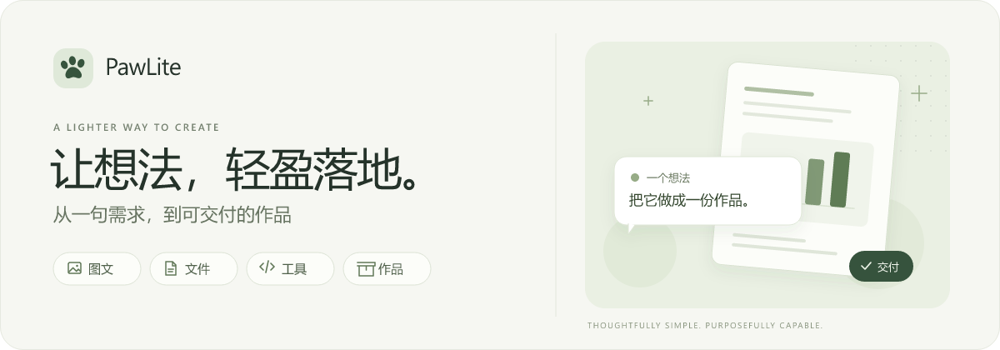
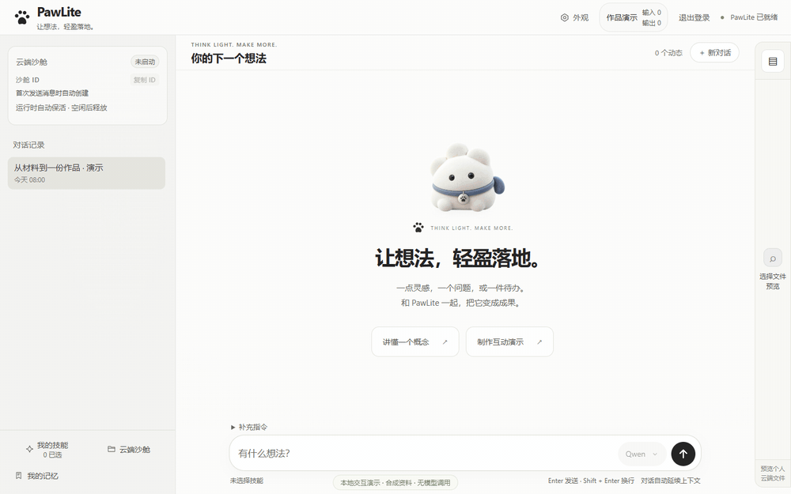
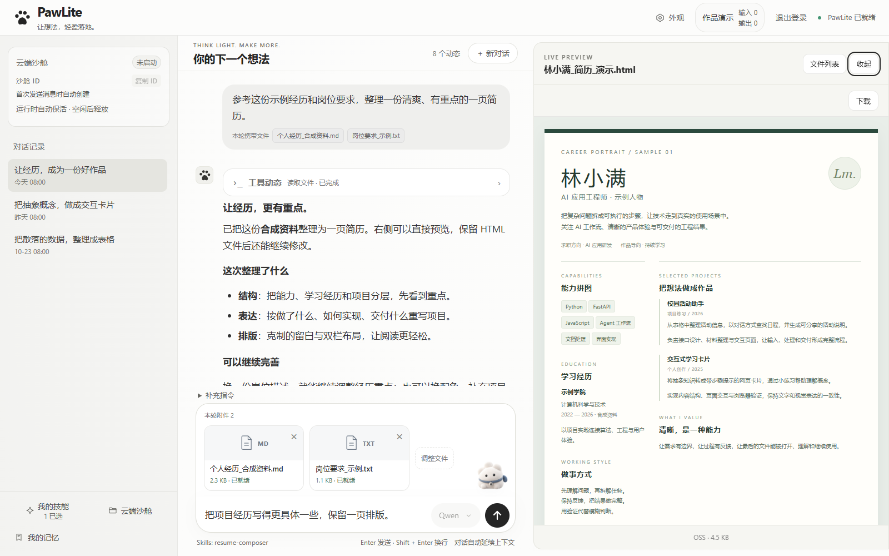
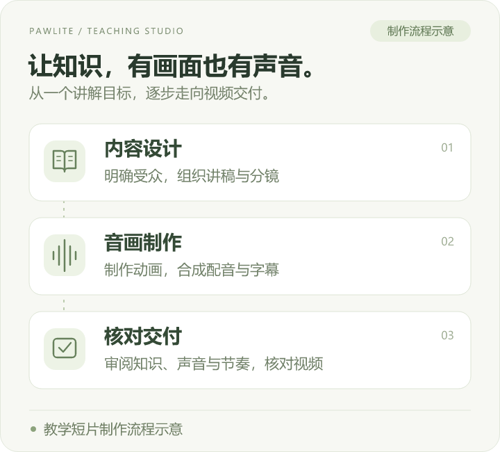
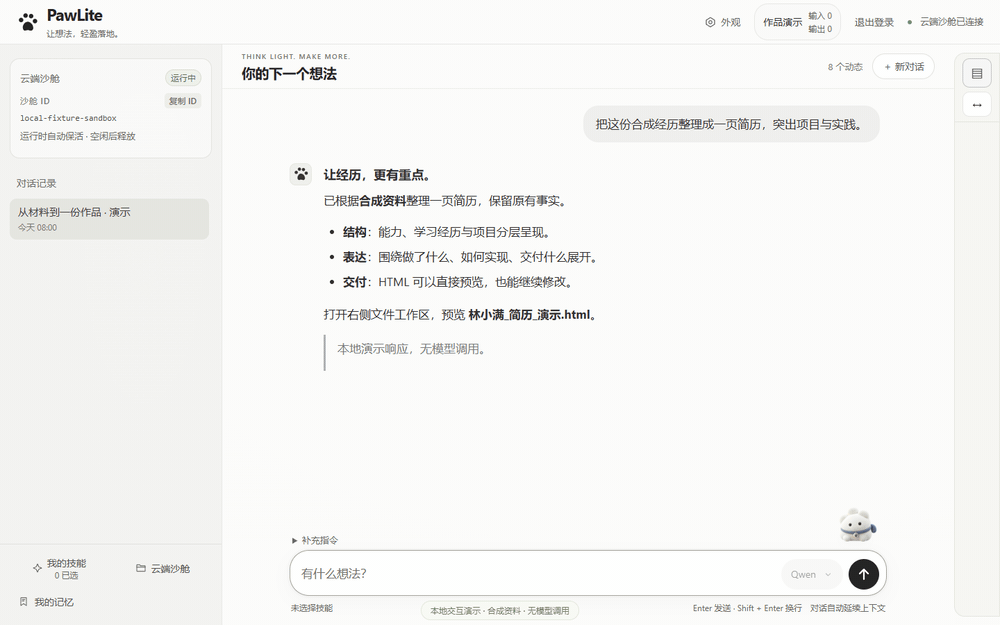
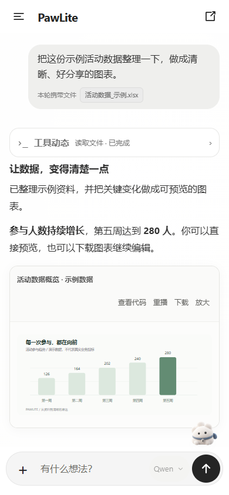
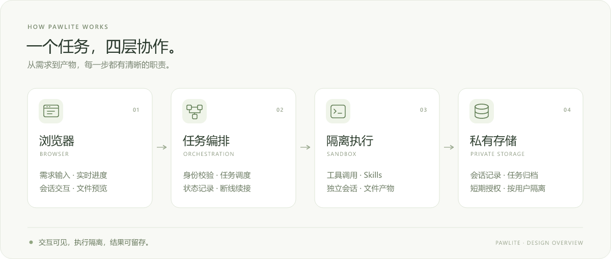

  

  <strong>轻量的个人 AI 助手，把想法做成作品。</strong> 
  带上资料，说清目标；看它思考、调用工具，把成果留在你的工作区。

  <a href="https://pawlite-ai.creamywhale259.chatgpt.site"><strong>在线体验 ↗</strong></a>
  &nbsp; · &nbsp;
  <a href="#把需求变成看得见的结果">功能与作品</a>
  &nbsp; · &nbsp;
  <a href="DESIGN.md">设计原理</a>

  <strong>过程及时呈现</strong> &nbsp; · &nbsp;
  <strong>返回查看进展</strong> &nbsp; · &nbsp;
  <strong>作品预览下载</strong>

 

  
   输入需求 → 流式反馈 → 工具动态 → 打开作品 · <a href="assets/pawlite-desktop.png">查看完整静态界面</a>
   实际前端交互 · 本地演示数据 · 动图播放节奏不代表模型响应耗时

## 把需求变成看得见的结果

一份表格、一段经历、一个想讲清楚的知识点，都可以成为工作的起点。PawLite 将对话、文件、工具执行和作品预览收进同一个界面：你说明目标，Agent 围绕资料开展工作，结果以能打开、能修改、能下载的文件交付。

[表格与图表](#01--数据整理成清楚的表达) · [简历与文档](#02--经历打磨成能交出去的简历) · [教学与配音](#03--知识变成有画面有声音的讲解) · [资料与技能](#04--资料与方法留给下一次工作)

### 01 / 数据，整理成清楚的表达

> “把这份活动数据整理一下，保留明细，再做一张能看懂的图表。”

选择本轮使用的表格，交代整理规则和展示目的。Agent 可以读取数据、清理和计算，生成表格、图表或汇总页面；正文、工具动态和阶段进度随执行逐步呈现。

**可以用来做：** 表格整理、指标汇总、数据可视化、图文报告。关键数值与公式按原始资料核对，最终文件可以下载继续加工。

### 02 / 经历，打磨成能交出去的简历

> “用这些经历和岗位要求做一份简历，先看页面，再给我 PDF。”

把个人材料和岗位要求带进工作区，围绕已有事实组织内容、调整表达和版式。简历流程提供 HTML 与文字可选中的 PDF，支持沿用已有稿件继续修改；页面效果和下载入口都保留在任务中。

  
   实际界面 · 合成人物与经历

**可以用来做：** 简历初稿、岗位适配、内容精炼与 A4 排版。经历、日期与能力等级仍以用户材料为准。

### 03 / 知识，变成有画面、有声音的讲解

> “把这个概念做成一段教学短片，配上讲解和字幕，让变化过程更直观。”

同一个 Agent 围绕目标组织讲解、设计画面、编写动画、调用语音合成并渲染视频。工具链支持配音、字幕与音画合成，也支持可暂停、跳步和交互的 HTML 教学演示。

  
   制作流程示意 · 真实成片待 PawLite 实际任务完成并审阅后补充

二维图解、数据变化与空间关系可以选择不同的呈现方式；视频和交互页面在任务里预览，原件归档后可下载。教学准确性、字幕节奏、声音和连续画面需要逐份审阅。

**可以用来做：** 概念解释、教学短片、配音讲解、数据演示与轻量动效作品。

### 04 / 资料与方法，留给下一次工作

> “这次继续用这些资料，按我选好的技能，把刚才的作品再改一版。”

文件按需选择进入本轮任务，粘贴图片随消息保存，个人 Skills 承载常用方法。会话、输入材料与产物保持关联，能围绕同一份工作继续提问、修订和交付。

  
   打开工作区 → 选择材料 → 选择技能 → 补充要求 · <a href="assets/pawlite-workspace.png">查看静态画面</a>
   实际前端交互 · 本地演示数据 · 动图播放节奏不代表模型响应耗时

**可以用来做：** 图文资料处理、个人方法复用、多轮作品修改与文件归档。

## 交互轻快，过程持续可见

PawLite 把等待拆成有意义的反馈：正文逐步展开，工具状态随执行变化，作品生成后出现预览与下载入口。输入、滚动和查看进度，都围绕连贯的操作体验优化。

- **边做边看。** 正文与工具动态持续呈现，随时了解当前进展。
- **回来接着看。** 优先呈现已保存的内容，再接收同一项工作的新动态。
- **少一些重复等待。** 合并界面刷新、复用未变化的内容，减少长文本和历史回放带来的重复处理。
- **需要时介入。** 停止当前任务，调整需求后基于已有材料继续交流；后续请求可以排队。

这里的“快”来自持续反馈、减少重复处理与复用已有状态。模型思考、工具运行和完整交付各有自己的等待时间。

→ [这些体验背后的设计](DESIGN.md#快速交互由哪些机制组成)

## 长任务，有来有回

制作视频、处理资料或多轮调试时，可以暂时离开页面。任务执行与浏览器连接分开管理；再次联网打开会话时，先看到已保存的内容，再查看同一项任务的新进展。

**查看 → 停止 → 补充要求 → 基于已有材料继续。** 页面上的“暂停”会停止当前执行，保留仍有效的会话与文件，后续可以继续交流；已经归档的作品也会留在历史任务中。

续接依赖有效的执行环境和持久化记录。页面重连、暂停后继续对话、后端观察者重新接回进程，是不同层次的恢复；执行环境丢失后的自动迁移仍需独立验证。

## 记忆分层，让下一次更顺手

PawLite 把“记住什么”拆成不同职责：

- **会话上下文**保存这项工作谈过什么、目前做到哪里。
- **文件与作品**保存实际资料和结果，继续工作时按需选择。
- **个人 Skills**保存可复用的方法，让不同任务沿用明确的工作约定。
- **个人偏好**单独保存，支持明确表达、查看与管理，避免把临时要求直接当作长期规则。

带来源的跨会话记忆、纠正与遗忘机制正在完善。设计重点是找得到出处、分得清作用范围、改得动和删得掉；自然跨会话回忆的完整效果仍需要持续验收。

## 离开电脑，也能接着用

桌面与手机共用账号和会话数据。移动端调整导航、工作区抽屉、输入区和作品预览，让查看任务、补充需求与打开文件自然衔接。

  
   实际界面 · 演示数据

## 界面背后的设计

  

**浏览器承载体验，服务端协调任务，Sandbox 执行工具，私有存储保存工作。** 四个部分围绕请求身份、状态快照和产物清单协作，让对话过程和最终交付连在一起。

**轻量来自职责清楚。** 不为每个应用方向再造一套任务系统；表格、简历和视频共用执行与归档链路，通过 Skills 和场景工具扩展。

**交付有凭据。** 工具执行结束后继续核对文件、确认归属并完成归档，预览与下载关联原任务。

→ [深入阅读：流式交互、长任务续接、分层记忆与作品交付](DESIGN.md)

## 实现基础与展示说明

原生 JavaScript / HTML / CSS · Python / FastAPI · 流式 HTTP / SSE · 云端 Sandbox · 私有对象存储 · Python / Node.js / FFmpeg / Remotion 与场景工具。

截图与动图使用当前前端和本地演示数据，展示实际布局与操作。动图按演示节奏编排，不代表线上模型响应耗时，也不作为真实任务成果记录。教学视频能力按已有实现介绍，成品示例将使用 PawLite 实际任务产物，经检查后补充。

本仓库公开产品介绍、界面图片和高层设计。完整业务源码、生产配置与用户数据保留在私有工程中。

 

  <strong>下一个想法，从这里开始。</strong>  
  <a href="https://pawlite-ai.creamywhale259.chatgpt.site"><strong>打开 PawLite，开始体验 ↗</strong></a>

